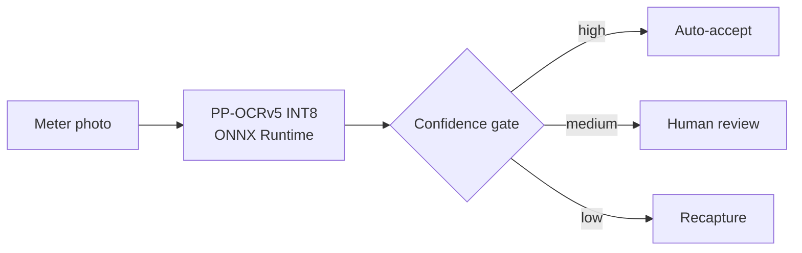

<!-- ============================== HEADER ============================== -->
<p align="center">
  
</p>

<p align="center">
  <a href="https://prince-portfolio.princeiith.workers.dev/">
    
  </a>
</p>

<p align="center">
  <a href="https://prince-portfolio.princeiith.workers.dev/"></a>
  <a href="https://www.linkedin.com/in/princeverma0411/"></a>
  <a href="mailto:tovermaprince@gmail.com"></a>
  <a href="https://youtube.com/@princeiithvlogs"></a>
  <a href="https://instagram.com/ig.prince04"></a>
</p>

---

## 👨‍💻 About Me

I build ML systems that hold up in production: models that are accurate on messy real-world data, fast on CPU and edge hardware, and wrapped in pipelines people can actually use.

```python
class PrinceVerma:
    role      = "AI/ML Engineer @ Coral Innovation Pvt. Ltd."
    education = ["M.Tech Smart Mobility, IIT Hyderabad (2026)",
                 "B.Tech, BBDNITM Lucknow (2022)"]
    focus     = ["Production OCR & Document AI",
                 "Computer Vision & Edge Deployment",
                 "Speech AI & Audio Deepfake Detection",
                 "RAG Pipelines & LLM Agents"]
    principle = "Ship models that run fast in production, not just in notebooks"
    open_to   = "Collaborations in ML, CV, NLP and Generative AI"
```

---

## 🚀 Featured Work

### 1. [Meter Serial OCR](https://github.com/PrinceVerma04/meter-serial-ocr): production OCR for utility meters
Fine-tuned **PaddleOCR PP-OCRv5** on field photos of meter nameplates and shipped it as a quantized CPU service.

- **83%** exact match on 21K serials the legacy OCR misread, and **93%** on the 18K images human review confirmed readable
- Retrained INT8 model: **99%** on new held-out images (up from 91%) and **91%** on hard human-reviewed images (up from 12%)
- Confidence gate auto-accepts **64%** of reads at **96.8% precision** on a 4.3K blind test, and holds **95.4%** accuracy on an unseen utility with no retraining
- INT8 post-training quantization: **81 MB → 21 MB** and **304 ms → 20 ms** per image on CPU (15× faster), with **98.6%** FP32-to-INT8 agreement after fixing a silent export failure
- Served as an **ONNX Runtime REST API** with Flask, Docker, systemd and health checks



`PaddleOCR` `ONNX Runtime` `INT8 PTQ` `Flask` `Docker` `systemd`

### 2. [Civic Monitor](https://github.com/PrinceVerma04/Civic-monitor): civic-issue detection on the edge
**YOLOv8m** detector for 10 civic-issue classes, trained on a 17,000+ image real-world dataset.

- **0.80 mAP@50 / 0.70 mAP@50-95** on a long-tailed detection task
- Audited the raw corpus, merged 7 confusable classes and quarantined **~4,500 mislabeled samples**
- Synthetic night / rain / fog augmentation for robustness in poor field conditions
- Compressed to an **INT8 TFLite model (~26 MB)** with NNAPI for real-time, fully offline on-device inference

`YOLOv8` `PyTorch` `TFLite` `NNAPI` `Data QA`

### 3. [NVIDIA NIM RAG Voice Assistant](https://github.com/PrinceVerma04/nvidia-nim-rag-voice-assistant): voice Q&A over PDFs
- PDF question answering with **NVIDIA NIM** LLMs and grounded, source-linked answers
- **FAISS** retrieval over NVIDIA embeddings
- Voice queries through **NVIDIA Canary ASR**, in a Streamlit chat interface

`NVIDIA NIM` `RAG` `FAISS` `Canary ASR` `Streamlit`

### 4. [Speaker Identification with X-Vectors](https://github.com/PrinceVerma04/Speaker-Identification--X-vector)
- Deep speaker identification and verification using the **X-Vector** architecture
- **93% accuracy** on multi-speaker datasets

`PyTorch` `X-Vector` `Speaker Recognition`

### 5. [SLIM-XA: Audio Deepfake Detection](https://github.com/PrinceVerma04/SLIM-with-cross-attention) · M.Tech Thesis
- Extends **SLIM (NeurIPS 2024)** with bidirectional 4-head cross-attention between Wav2Vec2-XLSR style and linguistic representations
- Two-stage training: real-only, then real/fake classification
- On ASVspoof 2019 LA: **90% accuracy**, **99.98% fake-speech recall**, 22.37% EER on unseen attacks

`Wav2Vec2-XLSR` `Cross-Attention` `ASVspoof`

---

## 🔬 Research

**WildSpoof Challenge · IEEE ICASSP 2026 Grand Challenge**: participated with a spoofing-aware speaker verification (SASV) system that rejects both wrong speakers and synthetic speech in noisy real-world audio. Worked with SpoofCeleb (2.5M+ utterances, 1,251 speakers, 23 TTS systems).

---

## 🛠️ Tech Stack

| Area | Tools |
|---|---|
| **Languages** |      |
| **Deep Learning** |     |
| **Computer Vision & OCR** |     |
| **Generative AI** |      |
| **Deployment & Optimization** |        |
| **Data & Tools** |       |

---

## 🏆 Achievements

- 🥇 **Winner**, AgriTech AI Hackathon 2025 (KIT Skill Hub & Pavaman Technologies)
- 🎯 **GATE 2024**, All India Rank **498**
- 🌏 Selected participant, Global Consumer Intelligence Program, Matsuo Laboratory, The University of Tokyo
- 🥈 2nd Prize, IIC & AICTE Ideation Contest (EV Charging through Smart Grid)

---

## 📊 GitHub Stats

<p align="center">
  
  
</p>

<p align="center">
  
</p>

<p align="center">
  
</p>

<p align="center">
  
</p>

<!-- ============================== FOOTER ============================== -->
<p align="center">
  
</p>
